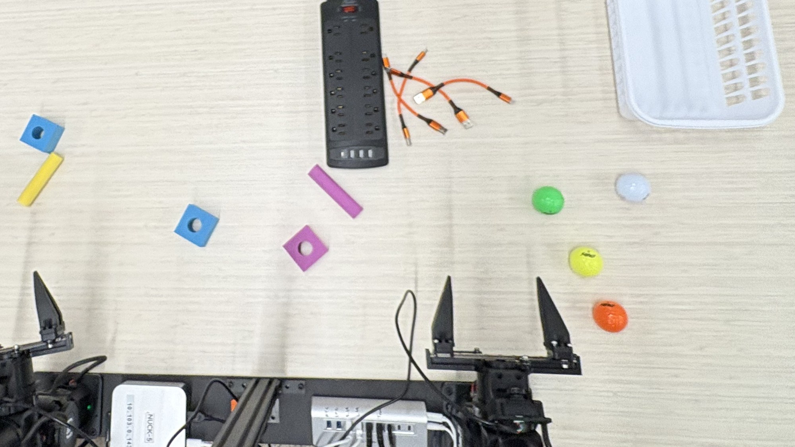

# task_simulation: testing the Hill Climb harness before the robot

This repo is everything needed to test and improve the Hill Climb relay harness (Physical AI Hacks, 7-8 Nov 2026)
without the real station: the harness itself, two simulators, the scenarios, the cluster scripts, the station
data they are based on, and the results so far.

The harness (`harness/`) supervises Dream-1 on the MakerMods Metal station: it sends one recorded task prompt per
stage, asks a Claude vision monitor whether the stage is done, retries, recovers, and stops on an illegal ball. It is
a copy of [hill-climb-harness](https://github.com/darshp848/hill-climb-harness) `main` at `f2f400e` (tower target,
subscription monitor backend, live visualizers, latency sweeps); port changes back there (or the other way) by
hand, the two repos don't sync themselves.

```
harness/            the harness (runner, plan parser, Claude monitor, station client, local detector)
plans/              hill_climb_v4.yaml (the match plan), table_colors.yaml (detector colours), other plans
experiments/        stress_match.py (offline sim), sim_match.py (MuJoCo matches), dual_arm_bench.py, STRESS_FINDINGS.md
sim_station.py      MuJoCo station with real Dream-1;  sim_scenes/hill_climb_table.py  the relay table + referee
fake_station.py     tiny HTTP stand-in for the station (unit tests, --mock)
cluster/            Dockerfile, run_matches.sh (MuJoCo), run_stress.sh (offline sweep)
tests/              189 tests; test_stress.py = whole-match scenarios, test_detect.py = detector on a real photo
data/               what the station logged on 7 Nov (inference log, last run trace, config), teleop dataset metadata
results/            stress sim tables (before / after the fixes) and the cluster's MuJoCo match logs (no images)
HARNESS_GUIDE.md    full harness manual;  HARNESS_README.md, DESIGN*.md, TELEOP_PLAN.md  harness design notes
```

## The real station



Station C at the hackathon, seen from above. Two MakerMods Metal arms (7 Damiao motors, brakeless, *not* YAM) sit on a
rail at the table's near edge (the bottom of the photo), with the overhead camera on a pole between them and a wrist
camera on each gripper. On the table: the power strip with the orange USB cables (Stage 1, the strip is unplugged
from the wall), blue and pink foam cubes with a hole and yellow / pink foam sticks (Stage 2), golf balls (Stage 3:
the coloured ones are legal, the **white** one is illegal) and the white bin. The target tower is Drive IMG_2697:
bottom to top blue cube, pink cube, blue cube (holes sideways), yellow square stick and pink round stick standing
upright (`tower_target` in `plans/hill_climb_v4.yaml`). The MuJoCo table in `sim_scenes/hill_climb_table.py` is an
estimate of this layout with the hub in front of the right arm; check its coordinates against the photo.

## Setup

Python 3.12 or 3.13.

```bash
python -m venv .venv && . .venv/bin/activate        # Windows: .venv\Scripts\activate  (macOS: python3.13)
pip install numpy pillow pyyaml scipy pytest
python -m pytest -q                                  # ~3 min; 4 tests skip without the dreamlabs package
```

The MuJoCo sim also needs `pip install "dreamlabs==1.0.37" mujoco` and a Dream key in `~/.dreamlabs/credentials`
(a line `DREAM_API_KEY=...`). The real Claude monitor needs either `ANTHROPIC_API_KEY` or a logged-in Claude
subscription (see below). Neither is needed for the offline sim or the tests. **Never commit a key**: `.gitignore`
covers `credentials` and `.env`, and this repo is public.

### Claude monitor on a Claude subscription (no API key)

With `--claude-backend subscription` (or `HARNESS_CLAUDE_BACKEND=subscription`), the `monitor` / `claude` verifiers
send their request (the same images, prompt, model and effort) through the Claude Code CLI, `claude -p`, which runs
on the subscription you're logged in to (`claude`, then `/login`). It runs with no tools, no MCP, no saved session,
and `ANTHROPIC_API_KEY` stripped from the CLI's environment. Default is still `api`.

```bash
python tools/check_monitor.py --backend subscription --sim    # live check: real monitor, real photo + sim renders
python -m harness plans/hill_climb_v4.yaml --live --verifier monitor --claude-backend subscription
```

`tools/check_monitor.py` asks the plan's own stage questions and the illegal-ball guard about a station photo
(`tests/data/table_c_topdown.jpg`) and MuJoCo renders with known answers (including a black 8-ball held in the right
gripper), and exits 1 on any wrong or unparseable answer. 7 Nov 2026, Haiku 5.5 on the subscription: 12/12 right
(guard yes on the held 8-ball both times, no on empty grippers), **latency median 8.4 s, max 12.7 s** per call
(~1 s of that is `claude` start-up). The stress sim assumes 4 s; at 9 s its happy path drops from ~95 to ~74
points (6 seeds), at 13 s to ~65, with no extra losses. So prefer the API for matches if latency matters (the model
alone takes 4.5-6 s, so expect 5 s or more there too).

**Plan tuned for the real monitor latency** (`experiments/sweep_variants.py`, 24 scenarios x 4 seeds,
`--latency 6.5-13`): taking the `skip_if_done` entry check (a synchronous monitor call) off `release_cable`,
`put_more_down` and `arms_clear` raised mean points 54.9 -> 60.0 with no new losses, and is now in
`plans/hill_climb_v4.yaml`. Also dropping the second unplug (`unplug_more` + `put_more_down`) reached 65.9 but
added two 8-ball losses in the scenarios where only the monitor guards the balls (none with `--detect`): left as a
strategy call. A harness change that waited at a timeout for a monitor verdict already in flight made no difference
(54.9 vs 54.8) and was dropped.

## Live visualizers

```bash
python experiments/live_stress.py -s black_ball --speed 10      # offline sim, in the browser (port 8765)
python sim_station.py --policy dream --scene hill_climb --open    # MuJoCo sim; web view at http://127.0.0.1:8093/live
.venv/bin/mjpython sim_station.py --policy scripted --scene hill_climb --realtime --viewer   # + native 3D window
```

- **`experiments/live_stress.py`**: one stress-sim match at N times real time (1x-30x or flat out), drawn live: hub
  ports, cables, the tower against the 4" bar, the bin, what the gripper holds, the policy's current try; the
  station state, monitor calls in flight and API outages; plan stages (active / done / skipped / failed); every
  table event and harness decision on a timeline; the referee's live score. Pick scenario, seed and speed, pause,
  or skip to the end on the page. Same match as `stress_match.py -s NAME` for that seed; logs in `runs_live/`.
- **`sim_station.py` `/live`** (view port, any policy, works headless and over SSH port-forwarding from the
  cluster): the three policy cameras (~5-15 fps), a ground-truth top-down map oriented like the overhead camera
  (blocks, golf and 8-balls, plugs, hub, bin, both TCPs with height), the referee (hill_climb scene), station state,
  prompt, last error and the last policy round trips.
- **`sim_station.py --viewer`**: MuJoCo's own 3D window (orbit / zoom with the mouse) with a status + referee overlay
  and Dream's three camera tiles. On macOS it must be started with `mjpython` (installed with mujoco in the venv).

## The two simulators

| | Offline stress sim | MuJoCo sim |
|---|---|---|
| Run | `python experiments/stress_match.py` | `python sim_station.py --policy dream --scene hill_climb` + `python experiments/sim_match.py` |
| Policy | rule-based table model (times and probabilities) | real Dream-1 over the Dream API |
| Monitor | scripted: answers from the table state at the frame's time | oracle: reads object positions |
| Clock | virtual, a 5-minute match in ~5 s | real time, ~5 min per match |
| Keys | none | Dream key |
| Tests | the harness's decisions under faults | policy + harness on a physical table |
| Blind spot | no physics, monitor never misjudges unless told to | base Dream-1 never gets past the first unplug |

Neither one tests what the real Claude monitor sees in camera frames. See "Next steps".

### Offline stress sim (`experiments/stress_match.py`)

The real `Runner` and the real `MonitorVerifier` run unchanged; the code around them is scripted:

- **VClock**: the harness's sleeps advance a virtual clock. A monitor call returns only after its virtual latency
  (default 4 s), so timing races between checks, verdicts and the policy are real.
- **Table + Behaviour**: cables in and out of the hub, what each gripper holds, the tower, balls in the bin. Each
  task prompt (T1-T6 of `TELEOP_PLAN.md`) has a try time and a success chance (`Behaviour` dataclass). Switches:
  `releases` / `open_frees` (the policy won't let go of the plug), `black_p` (picks an illegal ball),
  `reach_across_p` (brushes a block during unplug = DQ), `knock_p`, `unplug_never`.
- **SimStation**: the station HTTP API in-process, with faults (`Fault(at, kind)`, `refuse={prompt substring: n}`)
  that use the exact error types and messages from `data/station_nuc_20261107/robots-inference.jsonl`: DA-4000
  refusals, ControlLoopError (empty action buffer), LinAlgError (SVD), gateway DA-5000, a dead arm.
- **SimFrames**: frames carry their capture time; freeze, empty, corrupt (non-JPEG) and lag (`frame_lag_s`).
- **Scripted**: replaces only the HTTP call to Claude. It finds the stage in the real prompt the harness built and
  answers from the table **as it was at the newest frame's time**. Options: `false_done`, API `outages`, 400 on a
  corrupt image, `fast_guard` (stands in for the local detector).
- **referee()**: rubric v4 points, DQ (a block touched before a cable is out, a ball before the tower passes), an
  illegal ball in the bin = loss.

```bash
python experiments/stress_match.py --list                     # scenarios
python experiments/stress_match.py --seeds 4 -j 4              # all scenarios, 4 seeds, 4 processes
python experiments/stress_match.py -s no_release --seeds 1 -v  # one match, event by event
python experiments/stress_match.py --seeds 20 -j 7 --out runs.jsonl   # one JSON line per match
```

**Add a scenario**: append a `Scenario(...)` to `SCENARIOS` at the bottom of `stress_match.py` (behaviour, faults,
outages, camera spans, latency, or another `plan=`). If it guards a fix, add an assertion to `tests/test_stress.py`.

### MuJoCo sim (`sim_station.py`, `experiments/sim_match.py`)

`sim_station.py --scene hill_climb` serves the station API on Dream's YAM MuJoCo simulator with the relay table
from `sim_scenes/hill_climb_table.py` (hub in front of the right arm, as the plan's prompts assume).
`sim_match.py` runs the unchanged harness and plan against it; its verifier is an oracle over `/objects`, and the
referee scores each match. Layout coordinates are estimates from photos.

## On the cluster

The home cluster's head node (Inspiron: 8 threads, Intel iGPU, no CUDA) holds the image and the shared folder
`/cluster/shared/dev/darsh/projects/hill_climb_sim` (repo checkout in `repo/`, results in `runs/`).

```bash
docker build -t hill-climb-sim -f cluster/Dockerfile cluster          # once per node
PLAN=plans/hill_climb_v4.yaml cluster/run_matches.sh 3 2 my_label      # MuJoCo: 3 workers x 2 matches, real Dream-1
cluster/run_stress.sh 50 7 sweep1                                     # offline: all scenarios x 50 seeds, 7 cores
SEED0=51 cluster/run_stress.sh 50 2 sweep1 happy black_ball           # another node: seeds 51-100
```

`run_matches.sh` gives each worker its own container (own ports), mounts the Dream key read-only from
`~/.dreamlabs/credentials`, and staggers start-up by 20 s. About 3 MuJoCo workers fit on the Inspiron. The offline
sweep is pure CPU (~5 s per match), so the small worker nodes can take seed ranges too.

## Status (8 Nov 2026)

The harness survives faults in simulation. We have no real per-stage success numbers yet. Cloud round 1 stopped at
12:05 UTC when the Dream account ran out of credits (`DA-1000 ... (disabled)`), so its numbers can't compare arms.
Full write-up: [LAST_NIGHT_2026-11-08.md](https://github.com/darshp848/hill-climb-harness/blob/main/docs/LAST_NIGHT_2026-11-08.md).

| Test | Kind | Result | Files |
|---|---|---|---|
| Offline stress, 37 scenarios x 5 seeds | simulated | `main` v4 60.5 points, final hybrid with live guard 69.8, no illegal-ball losses | `results/stress/final_20261108/` |
| Before and after the fixes, 4 seeds | simulated | table in the section below | `results/stress/` |
| MuJoCo with real Dream-1, 25 matches | sim table, real model | cable out in 14 of 25, first unplug median 57 s, put-down 0 of 54 tries, stack 0 of 25, balls never reached | `results/cluster_mujoco/` |
| Cloud round 1 | sim table, real model | 10 of 28 valid, 0-42 points, stopped by credits | `results/cloud_round1_20261108/` |
| Judge benchmark | real model calls | GPT-6.1 Terra best per decision: 98% done, 97% guard at 2.8 s, 100%/100% at 3.7 s with low reasoning | `results/judge_bench_20261108/` |
| Station logs, 52 runs, 1650 calls | real | Dream round trip median 1115 ms, 90th percentile 2732 ms, success not logged | `data/station_nuc_20261108_late/` |

Plots are in `results/plots/`. The notes and briefs from the night are in `docs/notes_20261108/`. Joint traces
(`joints.jsonl`) stayed in the GCS bucket because of their size.

To rerun: `cluster/run_stress.sh 50 7 sweep1` for the offline sweep and `cluster/run_matches.sh` for MuJoCo, see
[On the cluster](#on-the-cluster). To aggregate the final runs, use `results/stress/final_20261108/analyze.py`. Probe
Dream with one call first, a disabled key fails every match. The GCP Batch jobs live on hill-climb-harness branch
`cloud-sims`.

To do, in order: pick the match branch, add the Dream check before batches, fix the 4 failing tests on `cloud-sims`, copy station logs, run matches on
the real table with per-stage logging, record stack and golf ball demos (colour order doesn't matter), and rerun round 1 with
fewer sessions.

## Results so far

Offline sim, 4 seeds each, points (full tables in `results/stress/`, write-up in `experiments/STRESS_FINDINGS.md`):

| Scenario | main before fixes (3055bf3) | main now (d938644) |
|---|---|---|
| happy path | 87 74 90 116 | 83 94 95 95 |
| Dream refusal on the first start | 0 0 0 0, match ended | 83 94 95 95 |
| empty action buffer mid-run | 10 10 15 15, ended | 79 94 95 100 |
| SVD did not converge | 10 0 10 10, ended | 83 84 95 95 |
| policy keeps the unplugged plug | plugged it back in 4/4 | never |
| 12 s of corrupt frames | 20 15 20 20 | 84-90 |
| arm dies | ended, then sent /start | ended, no /start |
| illegal ball picked 30% of tries (6 seeds, frames 2 s old) | lost 4/6 (monitor guard) | lost 2/6 with the local detector guard |
| unplug brushes a block | DQ 4/4 | DQ 4/4: only the policy or the layout can fix this |

MuJoCo, base Dream-1, 25 matches on the cluster (`results/cluster_mujoco/`): a cable out in 14 of 25 (time to
first unplug median 57 s, 28-269 s); 3 DQs, all with the hub on the left; never past the unplug, because the policy
keeps holding the plug.

Real station, 7 Nov (`data/station_nuc_20261107/`): 42 policy runs, 10 errors (DA-4000 refusals x4, SVD x3, empty
buffer x2, session expired x1); run outcomes were not logged. Human teleop: unplug median 8.5 s (15 demos), put-down
4.8 s (9 demos).

## Classifiers

- **Stage monitor and guard**: Claude `claude-haiku-5-5` (set on the `claude:` line of `plans/hill_climb_v4.yaml`),
  `max_tokens` 4000. It gets the stage-start frame, the last 6 overhead frames and the newest wrist frames, and
  answers JSON (done, progress, status, recovery, holding, guard).
- **Local detector** (`--detect plans/table_colors.yaml`, `harness/detect.py`): no ML. HSV thresholds, blobs,
  and a shape test (ball / cube / lying stick). It answers the illegal-ball guard on every poll from the wrist
  cameras and draws labelled boxes on the monitor's frames. On our table the **white** golf ball is illegal and the
  coloured ones are legal. Colours were tuned on a phone photo; re-check them on the station cameras:
  `python -m harness.detect plans/table_colors.yaml frame.jpg --out boxed.jpg`.
- Dream-1 drives the arms; neither classifier changes its inputs or its prompts (prompts must match the recorded
  task texts word for word, see `TELEOP_PLAN.md`).

## Next steps

1. **Real monitor in the loop**: with `ANTHROPIC_API_KEY` on the cluster, run `sim_match.py` with `MonitorVerifier`
   instead of the oracle and compare its verdicts with the referee's ground truth (false and late "done" rates).
2. **Seed sweeps**: `run_stress.sh` with 50+ seeds per scenario, then sweep plan knobs (`timeout_s`, `confirm`,
   `check_every_s`, `max_blind_s`, number of `higher_*` blocks) against points and loss rate.
3. **Real numbers into `Behaviour`**: run station tests through the harness (its logs record success per stage) and
   replace the assumed try times and success chances.
4. **Detector on station frames**: tune `table_colors.yaml` on overhead and wrist frames, with the gripper open and
   closed around a white ball.
5. Port anything that changes `harness/` or `plans/` back to hill-climb-harness.
